# Architecture Lakehouse (P08)

## 1. Flux

```mermaid
flowchart LR
  A["London Datastore : ZIP + Tariffs.xlsx"] --> B["HDFS raw : /p08/raw/meters et /p08/raw/tariffs"]
  B --> C["Normalisation (job map-only, proposé)"]
  C --> D["HDFS silver : /p08/silver/half_hourly"]
  C --> Q["HDFS quarantine : /p08/quarantine"]
  D --> E["MR1 Java : profils journaliers"]
  E --> F["HDFS gold : /p08/gold/mr1_daily"]
  F --> G["MR2 Java : mensuel, pics, coûts"]
  T["Tarifs 2013 (cache distribué)"] --> G
  G --> H["HDFS gold : /p08/gold/mr2_monthly"]
  F --> I["Import SQL : Hive 4 ou Spark SQL"]
  H --> I
  I --> J["Tables Iceberg : iceberg.daily et iceberg.monthly"]
  J --> K["Requêtes SQL et tableau de bord"]
```

## 2. Qui fait quoi
- MapReduce (Java) : normalisation, MR1, MR2. Calculs distribués.
- Moteur SQL (Hive 4 ou Spark SQL) : création, remplissage et interrogation des tables Iceberg. MapReduce n'écrit pas dans Iceberg.
- Spark, s'il est retenu, sert uniquement à l'import et aux requêtes.

## 3. Zones et tables
| Zone ou table | Contenu | Producteur, consommateur |
|---|---|---|
| raw_meters | CSV d'origine, immuables | Acquisition, préparation |
| raw_tariffs | Tariffs.xlsx d'origine | Acquisition, conversion des prix |
| silver_half_hourly | Relevés normalisés et valides | Préparation, MR1 |
| quarantine | Lignes rejetées avec motif | Préparation, contrôle qualité |
| mr1_daily | Profil journalier par foyer, pic, complétude | MR1, MR2 et publication |
| mr2_monthly | kWh, pic, coût indicatif, couverture de prix | MR2, publication |
| iceberg.daily | Table Iceberg des profils journaliers | Import SQL, analyse |
| iceberg.monthly | Table Iceberg des agrégats mensuels | Import SQL, analyse |

Chaque table analytique contient dataset_version, run_id, la période, les effectifs et des indicateurs de qualité.

## 4. Lambda, Kappa, Lakehouse
| Critère | Lambda | Kappa | Lakehouse (retenu) |
|---|---|---|---|
| Besoin | Batch et flux rapide | Flux et rejeu au centre | Historique et analyse |
| Nos données | Pas de temps réel à servir | Aucun flux natif | Relevés historiques et tables de résultats |
| MapReduce | Possible en couche batch | Pas un moteur de flux | Deux jobs batch indispensables |
| Coût | Deux branches à maintenir | Kafka à justifier, flux simulé | HDFS, jobs, moteur SQL Iceberg |

Choix : les données sont historiques et le sujet porte sur la qualité, les agrégats et leur réutilisation. Le Lakehouse n'est valide que si les tables et leurs métadonnées existent réellement.

## 5. Environnement
Conteneurs Docker (Docker Compose) prévus en semaine 2 : Hadoop pseudo-distribué (HDFS, YARN, MapReduce) et moteur SQL Iceberg. Versions à figer dans le README (NF04).

## 6. Pile Iceberg
Deux options : Hive 4 avec Iceberg, ou Spark SQL limité à l'import et aux requêtes. Décision après un test minimal en semaine 2 (table jouet créée et interrogée). Versions à renseigner après vérification de compatibilité avec la version de Hadoop.

## 7. Questions analytiques
1. Quel est le profil moyen par créneau pour Std et pour ToU ?
2. À quels créneaux se produisent les pics ?
3. Comment évolue la consommation mensuelle ?
4. Quel est le coût estimé des foyers ToU en 2013, avec quelle couverture de prix ?
5. Quelles différences descriptives entre Std et ToU sur une période commune, sans conclure à un effet causal ?
